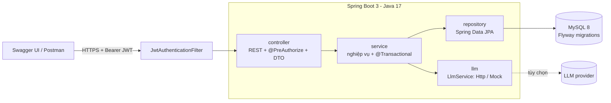

# Kiến trúc SmartStock

## 1. Tổng quan



**Mô hình MVC theo tầng (Controller -> Service -> Repository)** + DTO + Dependency Injection (constructor injection qua Lombok `@RequiredArgsConstructor`).

## 2. Vì sao MVC (monolith) mà không phải MSA?

- Một kho, ~200 sản phẩm, một nhóm 5 người, thời gian ~10 ngày: chi phí vận hành MSA (service discovery, gateway, giao dịch phân tán, deploy nhiều service) lớn hơn nhiều so với lợi ích.
- Nghiệp vụ cốt lõi cần **một transaction ACID** (xác nhận phiếu + cập nhật tồn kho nhiều dòng). Tách service sẽ kéo theo saga/eventual consistency - phức tạp không cần thiết.
- Ranh giới module vẫn rõ (package theo tầng + theo domain) nên **có thể tách MSA sau** nếu quy mô tăng: ứng viên tách đầu tiên là `llm` (phụ thuộc bên ngoài, tải khác) và `report` (đọc nặng).

## 3. Cấu trúc package

```
com.freshmart.smartstock
|-- SmartStockApplication
|-- config/        AppProperties, SecurityConfig, OpenApiConfig, ClockConfig, LlmConfig, DataSeeder
|-- security/      JwtService, JwtAuthenticationFilter, AuthUser, SecurityUtils, 401/403 handlers
|-- common/
|   |-- api/       ApiResponse, PageResponse
|   `-- exception/ ApiException, GlobalExceptionHandler
|-- domain/
|   |-- entity/    User, Category, Product, Supplier, StockReceipt(+Detail), StockIssue(+Detail), DocumentCounter
|   `-- enums/     Role, DocumentStatus, IssueReason
|-- repository/    Spring Data JPA repositories
|-- dto/           request/response records, nhóm theo feature (auth, user, product, receipt, issue, inventory, llm ...)
|-- service/       interfaces + DocumentCodeGenerator;  service/impl/ = triển khai
|-- controller/    REST controllers (mỏng: validate -> gọi service -> bọc ApiResponse)
`-- llm/           LlmService, MockLlmService, HttpLlmService, PromptTemplates
resources/
|-- db/migration/  V1__init_schema.sql, ... (Flyway)
`-- prompts/       receipt-parse-v1.system.txt / .user.txt
```

Quy tắc phụ thuộc: `controller -> service -> repository`. Controller **không** gọi repository; service **không** biết HTTP; entity **không** ra khỏi service (chỉ DTO).

## 4. Luồng một request

1. `JwtAuthenticationFilter` đọc `Authorization: Bearer`, hợp lệ -> đặt `AuthUser` vào `SecurityContext`.
2. Không hợp lệ + URL cần bảo vệ -> `RestAuthenticationEntryPoint` trả **401**. Hợp lệ nhưng `@PreAuthorize` từ chối -> **403**.
3. Controller validate DTO (`@Valid`) -> sai thì `GlobalExceptionHandler` trả **400** kèm lỗi từng trường.
4. Service chạy nghiệp vụ trong `@Transactional`; lỗi nghiệp vụ ném `ApiException` (404/409/...), toàn bộ transaction rollback.
5. Kết quả bọc `ApiResponse{status,message,data}`.

## 5. Thiết kế phần khó

**Xác nhận chứng từ & tồn kho (Member C)**
- Một `@Transactional` duy nhất: tải chứng từ -> kiểm tra quyền/trạng thái -> khóa các sản phẩm liên quan bằng `ProductRepository.findAllByIdForUpdate(ids)` (đã sắp xếp theo id để tránh deadlock) -> kiểm tra **tất cả** dòng -> cập nhật tồn -> đổi trạng thái + `confirmedAt`.
- Có dòng vượt tồn -> ném `ApiException.conflict(..., List<ShortageItem>)` trước khi sửa bất kỳ dòng nào; rollback không để lại dấu vết.
- Lớp chặn cuối ở DB: `CHECK (quantity_in_stock >= 0)`.

**Sinh mã chứng từ**: `DocumentCodeGenerator` + bảng `document_counters` (khóa `PESSIMISTIC_WRITE` theo `(prefix, ngày)`), gọi trong cùng transaction tạo chứng từ.

**Bảo mật**: BCrypt; JWT HS256 60 phút; secret >= 32 byte đọc từ biến môi trường; không log token/mật khẩu; 401 dùng một thông báo duy nhất cho mọi lỗi đăng nhập; UserId chỉ lấy từ token.

**LLM (Member E)**: `LlmService` là interface; không có API key -> `MockLlmService`. Kết quả chỉ là **đề xuất**: backend parse JSON, kiểm `productId` tồn tại + `quantity > 0`, không tự lưu chứng từ. Prompt nằm trong file `prompts/`, có version (`v1`, `v2` ...) để so sánh độ chính xác trước/sau trên 8 hóa đơn mẫu.

## 6. Cấu hình & bí mật

| Thứ cần giấu | Cách cấp | Ghi chú |
|---|---|---|
| DB URL/user/password | env `DB_URL`, `DB_USERNAME`, `DB_PASSWORD` hoặc `application-local.yml` | file local bị `.gitignore` |
| JWT secret | env `JWT_SECRET` (>= 32 ký tự) | thiếu -> app **không khởi động** |
| LLM API key | env `LLM_API_KEY` | trống -> dùng mock |

Tương đương .NET User Secrets: `application-local.yml` (gitignored) + biến môi trường.
