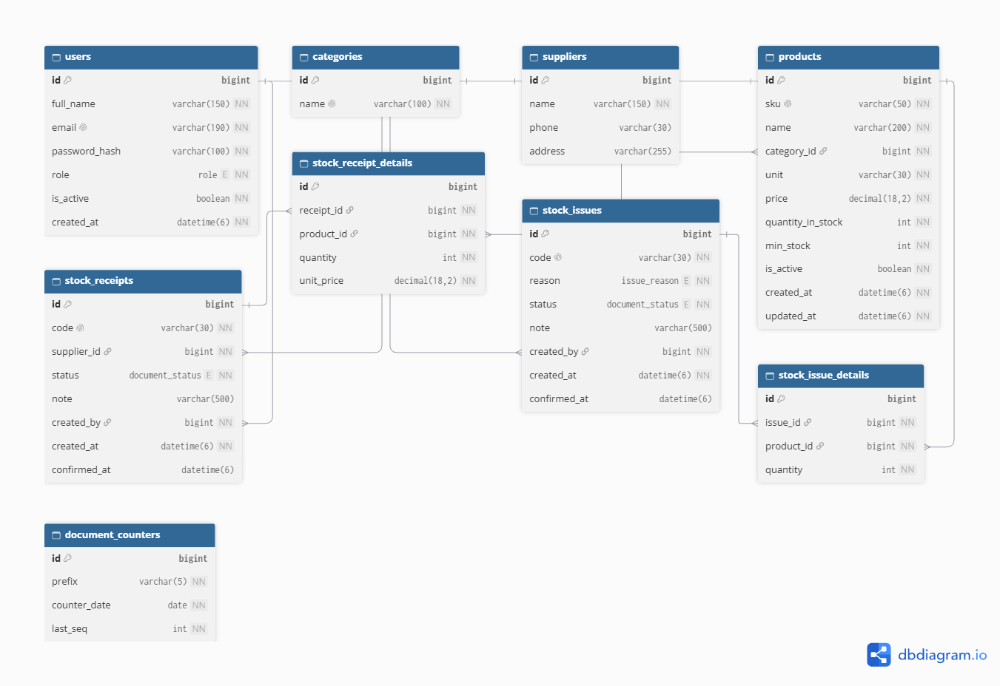
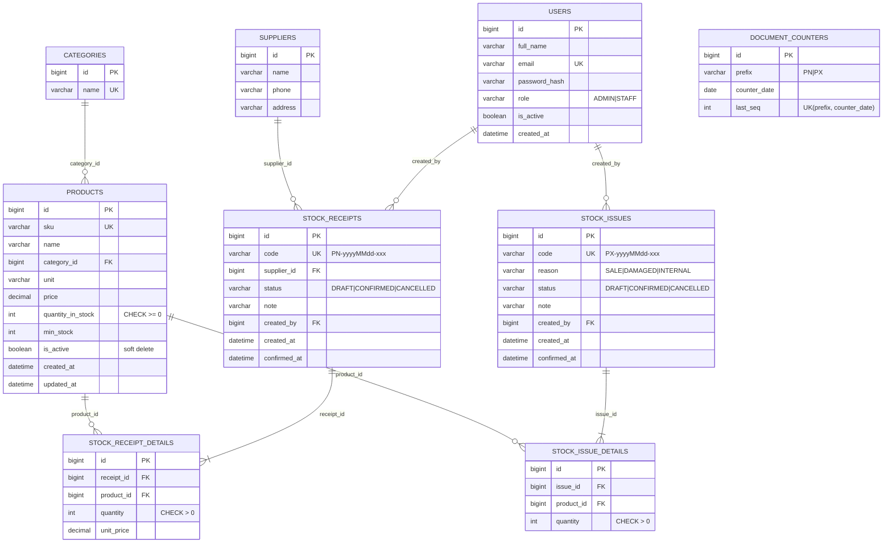

# ERD - SmartStock

> Owner: Member A. Schema thật nằm ở `src/main/resources/db/migration/V1__init_schema.sql` (Flyway). Hình nộp: `docs/erd.png`, vẽ bằng dbdiagram.io từ `docs/erd.dbml`, đúng 9 bảng và mọi FK của V1.

Sửa sơ đồ: mở https://dbdiagram.io, dán nội dung `docs/erd.dbml` vào khung soạn thảo, chỉnh rồi xuất lại PNG. Khi đổi schema thì sửa migration trước, sau đó cập nhật file DBML.

## Quan hệ và lý do thiết kế (chuẩn bị cho slide 3)

| Quan hệ | Kiểu | Vì sao |
|---|---|---|
| Category -> Product | 1 - N | Mỗi sản phẩm thuộc đúng 1 danh mục; lọc theo `categoryId`. |
| Supplier -> StockReceipt | 1 - N | Mỗi phiếu nhập từ 1 NCC; NCC có thể có nhiều phiếu. |
| StockReceipt -> StockReceiptDetail | 1 - N (bắt buộc >= 1) | Tách **header/detail** để một phiếu có nhiều dòng (chuẩn hóa, không lặp cột). `ON DELETE CASCADE`. |
| StockIssue -> StockIssueDetail | 1 - N | Như trên. |
| Product -> *Detail | 1 - N | Truy vết mọi biến động của 1 sản phẩm (lịch sử, báo cáo). |
| User -> StockReceipt / StockIssue (`created_by`) | 1 - N | Truy vết ai tạo; cơ sở của quy tắc "STAFF chỉ thao tác phiếu của mình". |
| (receipt_id, product_id), (issue_id, product_id) | UNIQUE | Chặn lặp sản phẩm trong cùng chứng từ ở tầng DB, không chỉ ở code. |

## Quyết định thiết kế cần giải thích được

1. **Vì sao có `quantity_in_stock` trong `products` (denormalize) thay vì tính từ tổng nhập - xuất?**
   Đọc tồn kho là thao tác nóng (danh sách sản phẩm, low-stock, chặn xuất quá tồn); cộng dồn hàng nghìn dòng mỗi lần là lãng phí. Đổi lại phải đảm bảo nhất quán: chỉ đổi trong transaction khi xác nhận chứng từ, khóa dòng sản phẩm (`SELECT ... FOR UPDATE`), thêm `CHECK (quantity_in_stock >= 0)` làm lớp chặn cuối. Lịch sử vẫn tính lại được từ các dòng chứng từ CONFIRMED.
2. **Vì sao soft delete (`is_active`) thay vì xóa sản phẩm?** Sản phẩm đã xuất hiện trong chứng từ cũ; xóa cứng làm hỏng khóa ngoại và lịch sử. Ẩn thì không thêm được vào chứng từ mới nhưng chứng từ cũ vẫn đọc được.
3. **Vì sao có bảng `document_counters`?** Sinh mã `PN-yyyyMMdd-xxx` reset mỗi ngày mà không cần job định kỳ: khóa theo `(prefix, ngày)`, tăng `last_seq` trong cùng transaction tạo chứng từ -> không trùng mã khi nhiều người tạo đồng thời.
4. **Vì sao không sửa chứng từ đã xác nhận?** Để sổ kho bất biến (audit). Sai sót -> tạo chứng từ điều chỉnh mới.

> Đề có nhắc "trả lời 3 câu hỏi thiết kế" ở slide 3 nhưng file đề không liệt kê 3 câu cụ thể. Bốn câu trên là phần nhóm tự chuẩn bị; **hỏi lại BTC/doanh nghiệp** để chắc chắn câu nào nằm trong 3 câu đó.

## Index đã có trong V1
`products(category_id)`, `products(name)`, `products(is_active, quantity_in_stock, min_stock)` (low-stock), `stock_receipts(status, created_at)`, `stock_receipts(created_by)`, tương tự cho `stock_issues`, và index theo `product_id` trên hai bảng detail (lịch sử sản phẩm).

### Kết quả `EXPLAIN` (MySQL 8.0, 24/11/2026)
Dữ liệu thử: 200 sản phẩm (5 danh mục, 10 sản phẩm ẩn), 2 000 phiếu nhập, mỗi phiếu 1 dòng; đã chạy `ANALYZE TABLE`.

| Truy vấn | Index được chọn | `type` / rows | Nhận xét |
|---|---|---|---|
| Tìm sản phẩm theo danh mục + từ khóa (`ProductRepository.search`) | `idx_products_category` | `ref` / 40 | Lọc danh mục bằng index; `LIKE '%kw%'` không dùng được B-tree nên lọc tiếp trên 40 dòng. **Giới hạn đã biết**, chấp nhận với ~200 sản phẩm. |
| Low-stock (`findLowStock`) | không dùng | `ALL` / 200 + filesort | `quantity_in_stock <= min_stock` so sánh **hai cột** nên không dò được bằng range; `is_active` chỉ có 2 giá trị. Quét 200 dòng < 1 ms -> không thêm index. |
| Danh sách phiếu theo trạng thái + khoảng ngày | `idx_stock_receipts_status_created` | `range` / 56 | Đúng thiết kế: lọc `status` rồi `created_at`, đọc ngược index cho `ORDER BY created_at DESC`. |
| Lịch sử một sản phẩm (detail JOIN phiếu) | `idx_receipt_details_product` + `PRIMARY` | `ref` / 10 + `eq_ref` | Index `product_id` trên bảng detail là index quan trọng nhất cho lịch sử và báo cáo. |

Kết luận: chưa cần `V2__add_indexes.sql`. Nếu báo cáo `stock-summary` chậm khi dữ liệu lớn, ứng viên đầu tiên là `stock_receipts(status, confirmed_at)` / `stock_issues(status, confirmed_at)` vì báo cáo lọc theo `confirmed_at`.

### Kiểm chứng entity <-> schema
- `SchemaMappingTest` khởi động app với `ddl-auto=validate` trên MySQL thật (Testcontainers): entity lệch migration -> test đỏ ngay, không đợi lúc chạy.
- `RepositoryQueryIntegrationTest` kiểm các query tự viết và ràng buộc DB (UNIQUE `(receipt_id, product_id)`, UNIQUE `(prefix, counter_date)`, `CHECK quantity_in_stock >= 0`).
- Lưu ý: MySQL báo vi phạm `CHECK` bằng mã 3819, Spring **không** dịch thành `DataIntegrityViolationException` mà thành `JpaSystemException` -> nếu lọt tới đó API trả 500. Vì vậy `CHECK` chỉ là lớp chặn cuối; service phải tự kiểm tồn trước khi trừ.
